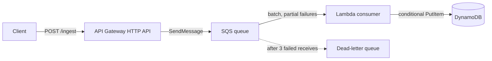
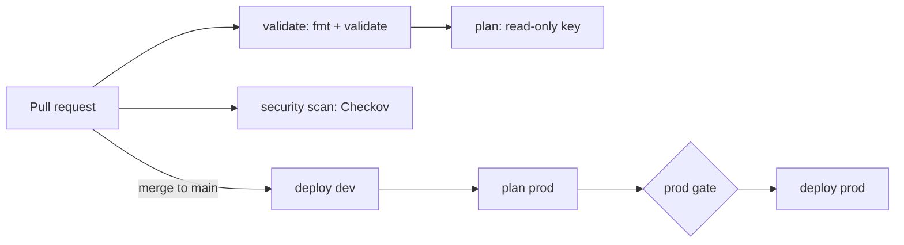

# Serverless event-driven ingestion (AWS + Terraform)

An HTTP endpoint that accepts JSON messages, buffers them in a queue, and
stores them in DynamoDB. Built with Terraform modules and deployed to a `dev`
environment with remote state.

## Architecture



## Design decisions

- **Queue between API and worker:** the API returns as soon as SQS accepts the
  message, so spikes are absorbed and a slow or failing consumer doesn't break
  the client.
- **At-least-once delivery, so idempotent writes:** the consumer uses a
  conditional put on `message_id`; redelivered messages are skipped.
- **Partial batch responses:** only failed messages return to the queue.
- **Dead-letter queue:** messages that fail 3 times are parked for inspection.
- **Visibility timeout = 6 x consumer timeout**, because one timeout covers a
  whole batch.
- **Least-privilege IAM:** the consumer can read one queue and `PutItem` on one
  table; API Gateway can `SendMessage` to one queue.

## Behaviour I tested

| Test | Result |
|---|---|
| Valid message through the API | Stored in DynamoDB |
| Invalid JSON through the API | Client gets success, message retried 3 times, lands in the DLQ |
| Same message delivered twice | One item stored, duplicate skipped |
| Batch with one bad record | Only the bad record reported as failed |

## Repository layout

```
modules/ingest-pipeline/   queue, DLQ, table, consumer, API integration
envs/dev/                  dev deployment (provider, S3 backend, module call)
consumer.py                SQS consumer Lambda
```

## Deploy

```
cd envs/dev
terraform init
terraform plan
terraform apply
```

Requires an AWS CLI profile and an S3 bucket for remote state (edit the backend
block in `envs/dev/versions.tf`).

## Not built yet / what I'd improve

- Authorization and throttling on the endpoint (it is currently open)
- Alarms on DLQ depth and queue age
- Separate AWS accounts and state per environment (test, prod)
- A CI/CD pipeline (plan on PR, gated deploy)
- Request validation at the API so bad input is rejected with a 400


## CI/CD pipeline (GitHub Actions)



| Stage | Trigger | Credentials | Purpose |
|---|---|---|---|
| validate | every PR | none | formatting and configuration errors |
| security scan | every PR | none | insecure settings (advisory, soft-fail) |
| plan | PR, after validate | read-only user | show reviewers exactly what will change |
| deploy dev | merge to main | dev apply user (environment secret) | automatic, serialized deploy |
| deploy prod | after dev succeeds | prod apply user (environment secret) | <state the gate you actually have: approval, or manual dispatch> |

### Decisions and trade-offs
- **No OIDC:** my AWS account is on the Free plan, and an organization policy blocked creating the GitHub OIDC provider. I used three scoped IAM users instead, with keys stored as GitHub secrets, created in the console so they never enter Terraform state.
- **Separate credentials per job type and per environment:** plan is read-only, dev and prod have separate apply users limited to their own role-name prefix and state path.
- **Serialized deploys** with `concurrency` and no cancel-in-progress, so two applies never race on one state.
- **Tested failures:** bad formatting and an invalid argument are stopped before plan, and a blocking scan fails the PR.

### What I'd change in production
- OIDC with short-lived credentials instead of stored keys
- Separate AWS accounts for dev, test and prod
- Required reviewers on prod, branch protection with required checks
- Save the plan and apply that exact file
- Scan findings triaged, then made blocking