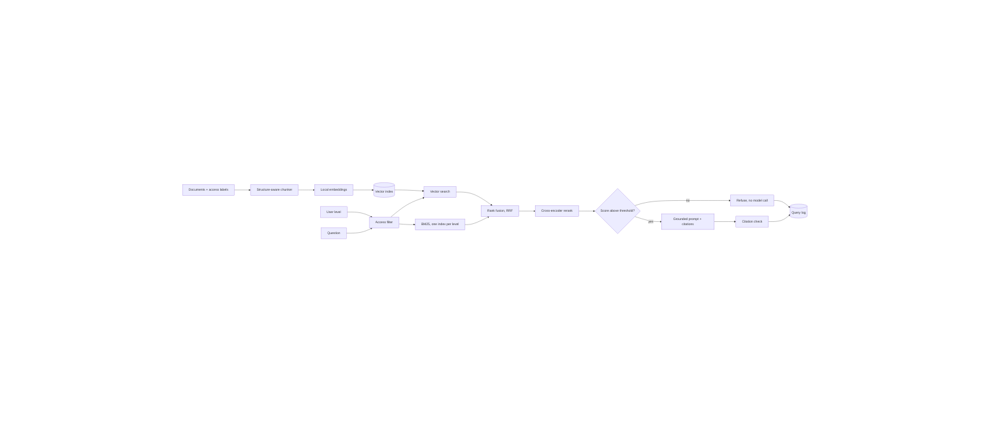

# RAG app: hybrid retrieval, permission filtering, measured results

A small retrieval-augmented generation pipeline over internal documents. It
filters by the user's access level, retrieves relevant passages, answers only
from them, cites passage IDs, and refuses when the documents don't contain the
answer. Built to practise the parts of RAG that fail in production: retrieval
quality, access control, refusal, and being able to measure and diagnose.

## Architecture



## What it does
- **Chunking:** splits on document headings, keeps the heading in the chunk text,
  and attaches `source`, `section`, `access` and `updated` metadata.
- **Access control:** the access filter runs before any ranking, so restricted
  text never reaches the ranker, the reranker or the model.
- **Retrieval:** vector search, then a cross-encoder reranker keeps the top 3.
- **Refusal:** if the best reranker score is below -2.11, the system
  answers "I don't know based on the provided documents" without calling a model.
- **Grounding:** the prompt says to use only the passages, cite each statement
  as [chunk-id], and treat passage text as untrusted data. A citation check
  flags cited IDs that were not retrieved.
- **Logging:** every query writes one JSON line (user level, retriever,
  retrieved chunks and scores, decision, answer, latency) so a wrong answer can
  be diagnosed as a retrieval or a generation problem.

## Corpus and evaluation set
- 9 fictional documents, 24 chunks. The labelled set has 14 questions of
  three types: exact-term (codes, IDs), paraphrase, and direct.
- Expected answers are stored as `source > section`, not chunk IDs, so the set
  survives re-chunking.

## Retrieval comparison (`python eval_retrieval.py`)

| Retriever | hit@1 | hit@3 | MRR | ms/query |
|---|---|---|---|---|
| vector | 11/14 | 13/14 | 0.871 | 15.0 |
| bm25 | 11/14 | 12/14 | 0.821 | 0.0 |
| hybrid (RRF) | 11/14 | 13/14 | 0.871 | 9.3 |
| vector + rerank | 13/14 | 14/14 | 0.964 | 1124.0 |
| hybrid + rerank | 13/14 | 14/14 | 0.964 | 1111.7 |

hit@1 by question type:

| Type | n | vector | bm25 | hybrid | vec+rerank | hyb+rerank |
|---|---|---|---|---|---|---|
| exact-term | 3 | 2 | 2 | 2 | 3 | 3 |
| paraphrase | 4 | 4 | 3 | 3 | 4 | 4 |
| direct | 7 | 5 | 6 | 6 | 6 | 6 |

MRR difference vs vector (bootstrap 95% interval): 
| bm25 | -0.05 | [-0.229, +0.079] | not distinguishable |
| hybrid (RRF) | 0.00 | [-0.107, +0.107] | not distinguishable |
| vector + rerank | +0.093 |[-0.050, +0.257] | not distinguishable |
| hybrid + rerank | +0.093 |[-0.050, +0.257] | not distinguishable |


### Decision: retrieval setup
- **Compared:** vector, BM25, hybrid (RRF), vector + rerank and hybrid + rerank
  on 14 labelled questions (3 exact-term, 4 paraphrase, 7 direct).
- **Without a reranker, no method beat vector search overall.** Vector, BM25 and
  hybrid each ranked the right chunk first on 11/14 questions (MRR 0.871, 0.821
  and 0.871). BM25 did not beat vectors on exact terms (2/3 each) and was worse
  on paraphrases (3/4 vs 4/4), but it was better on direct questions (6/7 vs
  5/7). Hybrid inherited both effects and netted out level with vector search.
- **The reranker was the only change that moved the numbers:** hit@1 rose from
  11/14 to 13/14, hit@3 from 13/14 to 14/14, and MRR from 0.871 to 0.964
  (+0.093). The two extra first places came from one exact-term question and
  one direct question.
- **Hybrid added nothing once reranked:** vector + rerank and hybrid + rerank
  were identical on every metric. With a corpus of 24 chunks, the first stage's
  pool of 20 candidates covers most of it, so the reranker sees nearly everything
  either way.
- **Is it real or noise?** No difference is distinguishable at 95%:

  | Method vs vector | MRR difference | 95% interval |
  |---|---|---|
  | bm25 | -0.050 | [-0.229, +0.079] |
  | hybrid (RRF) | 0.000 | [-0.107, +0.107] |
  | vector + rerank | +0.093 | [-0.050, +0.257] |
  | hybrid + rerank | +0.093 | [-0.050, +0.257] |

- **Cost:** reranking raises latency from about 15 ms to about 1.1 s per query on
  a laptop CPU (roughly 75x). Timings are rough (BM25 rounds to 0.0 ms, and
  hybrid measured faster than vector although it contains a vector search), so
  only the order of magnitude is meaningful.
- **Chosen: vector + rerank.** It has the best point estimates, and hit@3 of
  14/14 means the correct evidence always reached the model's top three
  passages. The refusal threshold is also based on reranker scores, so the
  reranker does a second job. Hybrid added code (a BM25 index per access level
  and rank fusion) with no measured gain, so it stays available as an option
  (`RAG_RETRIEVER=hybrid+rerank`) and is not the default.
- **Alternative considered:** vector search alone is about 75x faster and is not
  distinguishable from the reranked setups on this set. I kept the reranker
  because of the refusal rule and because the gain, though unproven, points the
  same way on hit@1, hit@3 and MRR. I would revisit hybrid on a larger corpus
  with many exact identifiers, where first-stage recall matters.
- **Caveat:** the questions (3 to 7 per type) were written after seeing the
  documents and were also used while building, so these numbers are optimistic.
  A held-out set is planned for Day 7.

## Access control (`python eval_access.py`)
- Labels: public, internal, restricted. Unknown or missing chunk labels are
  treated as restricted, and an unknown user level gets public access.
- BM25 indexes are built per level from visible chunks only, so word
  statistics don't leak restricted content.
- A refusal looks the same whether the answer is restricted or absent.
- Results: leaks 0 across all questions and levels. Questions answerable at
  public / internal / restricted: 8 / 11 / 14 of 14.
- The leak check was verified by breaking the filter on purpose and seeing the
  test fail.

## Tests and CI
| Check | What it covers | Where it runs |
|---|---|---|
| Unit tests (15 tests) | BM25, rank fusion, access rules (no model needed) | rag-ci on every PR |
| Syntax check, chunk build | files compile, documents chunk | rag-ci on every PR |
| `eval_retrieval.py`, `eval_access.py`, `calibrate.py` | retrieval quality, leaks, refusal threshold | local for now |

## Design decisions and trade-offs
- **Local embeddings and a NumPy index:** Bedrock access was still being
  verified on my account, and a local setup kept the project working. Changing
  the embedding model means rebuilding the index.
- **Brute-force search:** fine for a few dozen chunks. At scale: OpenSearch or
  pgvector, with the access filter inside the database query.
- **Reciprocal rank fusion:** combines ranks because vector and BM25 scores are
  on different scales.
- **Filter before ranking, fail closed, per-level BM25:** the model is not a
  security boundary.
- **Logs are not committed:** they can contain sensitive user questions.

## Known limits
- Small, fictional corpus and 14 questions written after seeing the
  documents, so numbers are indicative. Per-type counts are very small, and a
  one-question difference is within noise.
- The setup was chosen on the same questions I developed against.
- A relevance score measures "on topic", not "contains the answer".
- Access is a single three-level hierarchy taken from an environment variable. A
  real system would use user identity and group ACLs synced from source systems.
- The citation check catches invented sources, not misread ones.
- Latency numbers are rough, from a small sample on a laptop.

## Next
A larger development set plus a held-out test set, faithfulness and
answer-quality checks, prompt-injection tests, and running the evaluation in CI.

## Run it
```
python -m venv .venv
.\.venv\Scripts\Activate.ps1
pip install -r requirements.txt
python chunker.py
python build_index.py
python -m unittest -q
python eval_retrieval.py
$env:RAG_USER_LEVEL="restricted"
python rag.py "How do I replay messages from the dead-letter queue?"
```
Set `RAG_GENERATOR=bedrock` to use a Bedrock model, if your account allows it.


