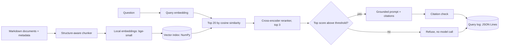

# RAG app: grounded answers with citations

A small retrieval-augmented generation pipeline over internal documents. It
retrieves relevant passages, answers only from them, cites the passage IDs, and
refuses when the documents don't contain the answer. Built to practise the
parts of RAG that fail in production: chunking, retrieval quality, refusal,
and diagnosability.

## Architecture



## What it does
- **Chunking:** splits on document headings, keeps the heading in the chunk
  text, caps chunk size at 800 characters with 120 characters of overlap, and
  attaches `source`, `section`, `access` and `updated` metadata to each chunk.
- **Retrieval:** two stages. Fast embedding search gets 20 candidates, then a
  cross-encoder reranker orders them and keeps the top 3.
- **Refusal:** if the best reranker score is below <threshold>, the system
  answers "I don't know based on the provided documents" without calling a model.
- **Grounding:** the prompt tells the model to use only the passages, cite each
  statement as [chunk-id], and treat passage text as untrusted data.
- **Citation check:** cited IDs are compared with the retrieved IDs, so a
  fabricated source is flagged.
- **Logging:** every query writes one JSON line (retrieved chunks, scores,
  decision, citations, answer, latency), so a wrong answer can be diagnosed as
  a retrieval problem or a generation problem.

## Results (measured on <n> hand-written questions over <8> chunks)

| Measure | Result |
|---|---|
| Chunks | <8> from <3> documents |
| Retrieval hit@1 / hit@3 | <6/6> / <6/6> |
| Refusal threshold | -2.11 (chosen from calibrate.py) |
| Lowest answerable score | 1.08 |
| Highest unanswerable score | -5.29 |
| Generator used | Bedrock Nova |

| Question type | Behaviour |
|---|---|
| Covered by one chunk | <answered, cited chunk-id> |
| Not covered at all | <refused_low_relevance> |
| On topic but not answered by the documents | <what actually happened> |

## Design decisions and trade-offs
- **Local embeddings and a NumPy index:** my AWS account's Bedrock access was
  still being verified, and a local setup kept the project working. Embedding
  and generation sit behind small functions so they can be swapped. Changing the
  embedding model means rebuilding the index.
- **Brute-force search:** fine for a few dozen chunks. At scale I'd use
  OpenSearch or pgvector for approximate nearest-neighbour search, persistence
  and metadata filtering.
- **Two-stage retrieval:** the bi-encoder is fast and good for recall, and the
  cross-encoder reads the question and passage together to fix the ordering.
- **Threshold chosen from data, not guessed:** reranker scores are raw model
  outputs, not probabilities.
- **Logs are not committed:** they can contain sensitive user questions.

## Known limits
- The documents are small and fictional, and the test set is small, so the
  numbers are indicative only.
- A relevance score measures "on topic", not "contains the answer", so a
  question about a covered topic that the documents don't answer can slip
  through the threshold. The model's own instruction and a faithfulness
  evaluation are the second line of defence.
- No permission filtering yet: chunks marked `restricted` can be returned to
  anyone.
- The citation check catches invented sources, not misread ones.

## Next
Hybrid search (BM25 plus vectors), permission filters applied before ranking,
a larger labelled test set, retrieval and faithfulness metrics, and running the
evaluation in CI.

## Run it
```
python -m venv .venv
.\.venv\Scripts\Activate.ps1
pip install -r requirements.txt
python chunker.py
python build_index.py
python rag.py "How do I replay messages from the dead-letter queue?"
```
Set `RAG_GENERATOR=bedrock` to use a Bedrock model, if your account allows it.