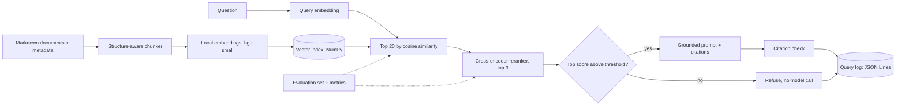

# RAG app: hybrid retrieval, grounded answers, measured results

A small retrieval-augmented generation pipeline over internal documents. It
retrieves relevant passages, answers only from them, cites the passage IDs, and
refuses when the documents don't contain the answer. It is built to practise
the parts of RAG that fail in production: chunking, retrieval quality,
refusal, and being able to measure and diagnose what went wrong.

## Architecture



## Corpus and evaluation set
- **Corpus:** <9> fictional Markdown documents (architecture, runbook, security,
  API reference, onboarding, incident report, cost, retention, FAQ), chunked
  into <n> chunks. Each chunk carries `source`, `section`, `access` and
  `updated` metadata.
- **Evaluation set:** <14> hand-written questions in `eval/questions.json`. The
  expected answer is stored as `source > section` (not a chunk ID), so the set
  survives re-chunking. Where two chunks genuinely answer a question, both are
  accepted. The set deliberately mixes:
  - exact-term questions (error codes, incident IDs)
  - paraphrased questions that share few words with the answer
  - questions answered by restricted documents

## Retrieval results (`python eval_retrieval.py`)

| Retriever | hit@1 | hit@3 | MRR |
|---|---|---|---|
| Vector (bge-small) | 11/14 | 13/14 | 0.871 |
| Vector + cross-encoder rerank | 13/14 | 14/14 | 0.964 |
| BM25 | (Day 6, Hour 2) | | |
| Hybrid (BM25 + vector, RRF) | (Day 6, Hour 3) | | |
| Hybrid + rerank | (Day 6, Hour 5) | | |

**What the misses show:** <one or two sentences, in your own words. For example:
which questions failed, and whether the cause was an exact term, a paraphrase,
a vaguely worded chunk, or an ambiguous question.>

- hit@1: the correct chunk was ranked first. hit@3: it was in the top three.
- MRR: the average of 1/rank of the first correct chunk, so it rewards ranking
  the right answer higher, not only finding it.

## Answer behaviour (refusal and grounding)

| Question type | Behaviour |
|---|---|
| Covered by one chunk | <answered, cites the chunk ID> |
| Not covered at all | <refused_low_relevance> |
| On topic but not answered by the documents | <what actually happened> |

- **Refusal:** if the best reranker score is below <threshold>, the system
  answers "I don't know based on the provided documents" without calling a
  model. The threshold was chosen from data (`calibrate.py`): lowest answerable
  score <x>, highest unanswerable score <y>.
- **Grounding:** the prompt tells the model to use only the passages, cite each
  statement as [chunk-id], and treat passage text as untrusted data.
- **Citation check:** cited IDs are compared with retrieved IDs, so a
  fabricated source is flagged.
- **Logging:** every query writes one JSON line (retrieved chunks, scores,
  decision, citations, answer, latency), so a wrong answer can be diagnosed as
  a retrieval problem or a generation problem.

## Design decisions and trade-offs
- **Local embeddings and a NumPy index:** my AWS account's Bedrock access was
  still being verified, and a local setup kept the project working. Embedding
  and generation sit behind small functions so they can be swapped. Changing
  the embedding model means rebuilding the index.
- **Brute-force search:** fine for a few dozen chunks. At scale I'd use
  OpenSearch or pgvector for approximate nearest-neighbour search, persistence
  and metadata filtering.
- **Two-stage retrieval:** the bi-encoder is fast and good for recall, and the
  cross-encoder reads the question and passage together to fix the ordering.
- **Evaluation before tuning:** retrieval changes are judged on the labelled
  set, not on a handful of questions tried by hand.
- **Threshold chosen from data, not guessed:** reranker scores are raw model
  outputs, not probabilities.
- **Logs are not committed:** they can contain sensitive user questions.

## Known limits
- The corpus is small and fictional, and <14> questions is a small test set, so
  the numbers are indicative, and a difference of one question is within noise.
- I wrote the questions after seeing the documents, so they are probably
  easier than real user questions.
- A relevance score measures "on topic", not "contains the answer", so a
  question about a covered topic that the documents don't answer can slip
  through the threshold. The model's own instruction and a faithfulness
  evaluation are the second line of defence.
- No permission filtering yet: chunks marked `restricted` can be returned to
  anyone.
- The citation check catches invented sources, not misread ones.

## Next
BM25 keyword search and hybrid ranking, permission filters applied before
ranking, a larger labelled set, faithfulness checks, and running the
evaluation in CI.

## Run it
```
python -m venv .venv
.\.venv\Scripts\Activate.ps1
pip install -r requirements.txt
python chunker.py
python build_index.py
python eval_retrieval.py
python rag.py "How do I replay messages from the dead-letter queue?"
```
Set `RAG_GENERATOR=bedrock` to use a Bedrock model, if your account allows it.